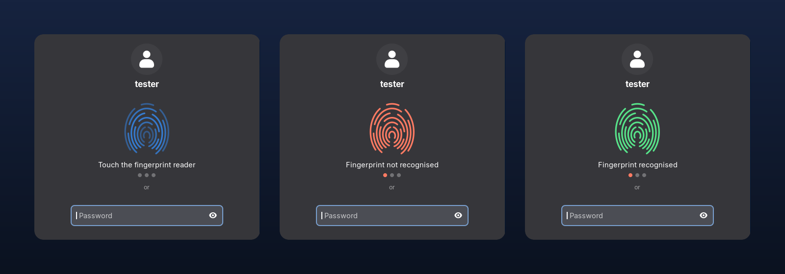
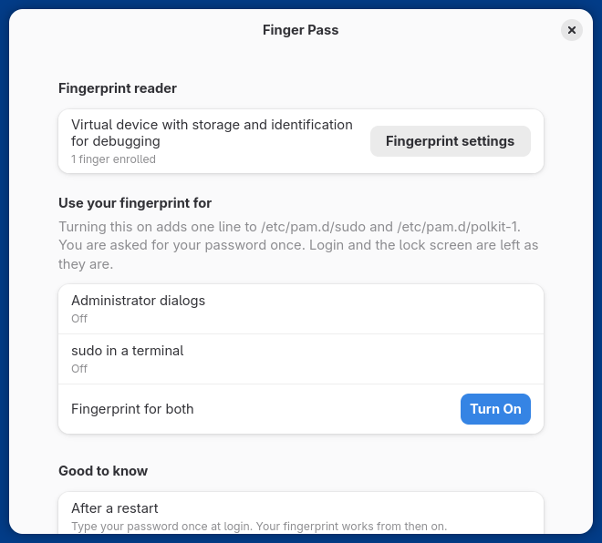
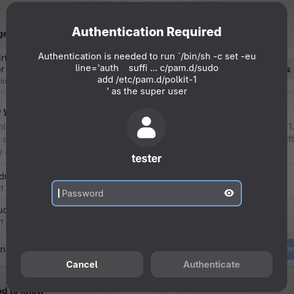
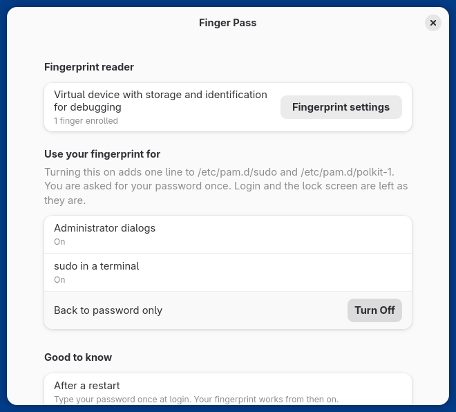
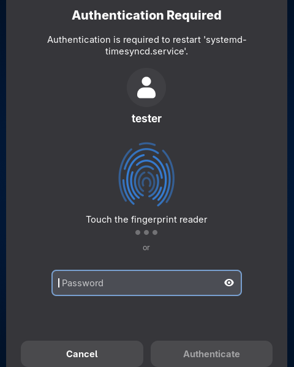
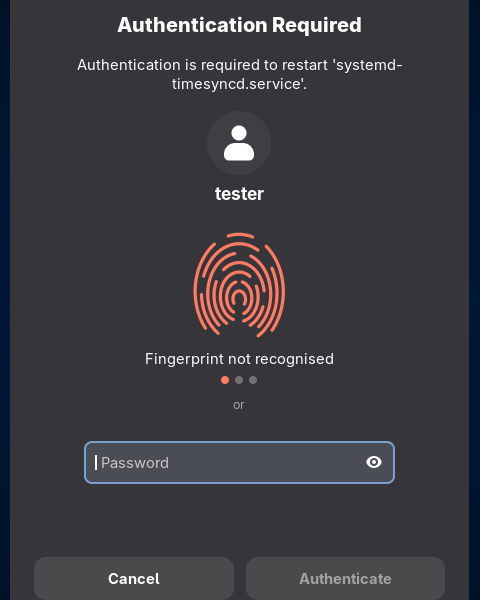
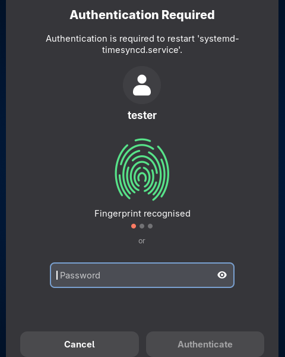
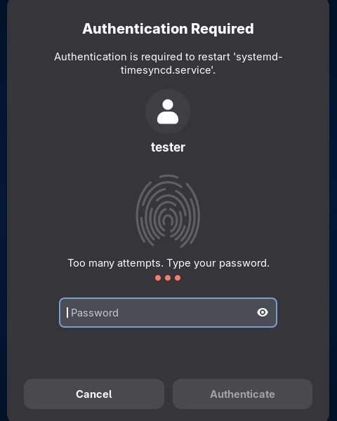
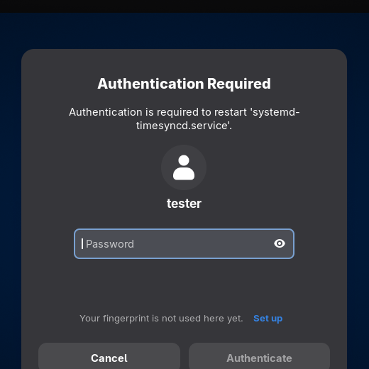
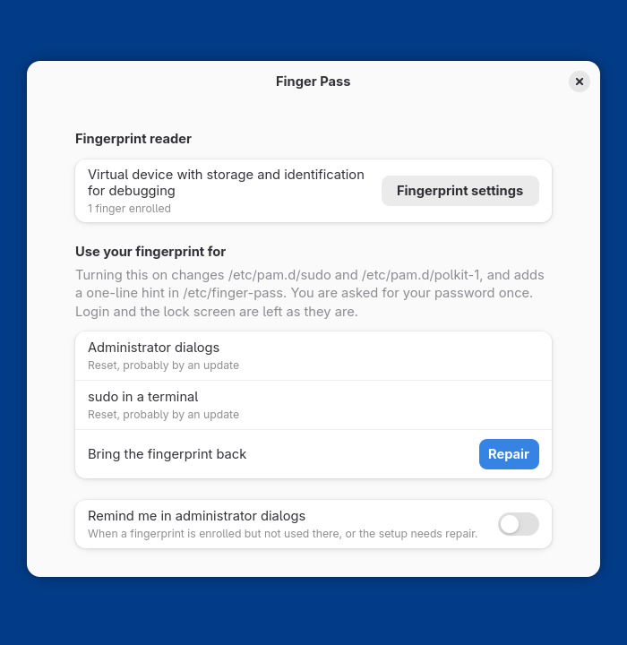

# Finger Pass, pas à pas

Finger Pass permet de répondre aux demandes d'administration avec votre
empreinte ou votre mot de passe, au premier des deux.

## Avant de commencer

Il faut un lecteur d'empreintes pris en charge par Linux et au moins un doigt
enregistré. Ouvrez **Paramètres › Système › Utilisateurs**, puis
**Connexion par empreinte digitale** pour en enregistrer un. Deux doigts
valent mieux qu'un.

## 1. Ouvrir les préférences

Ouvrez l'application **Extensions**, cherchez **Finger Pass** et cliquez sur
son bouton de réglages. La fenêtre montre votre lecteur, le nombre de doigts
enregistrés et les endroits où l'empreinte est utilisée. Sur un système neuf,
les deux lignes indiquent *Désactivé*.

## 2. Activer

Cliquez sur **Activer**. Votre mot de passe est demandé une seule fois. La
fenêtre affiche la commande exacte qui va s'exécuter en administrateur : elle
ajoute une ligne à `/etc/pam.d/sudo` et à `/etc/pam.d/polkit-1`, après avoir
sauvegardé les originaux dans `/var/backups/finger-pass`.

Les deux lignes indiquent maintenant *Activé*.

## 3. Utiliser

Dès qu'une application demande les droits d'administration, la fenêtre montre
le lecteur et le champ du mot de passe ensemble. Posez le doigt ou commencez
à taper : il n'y a rien à attendre.

Un doigt non reconnu fait passer l'empreinte au rouge et consomme un des trois
essais. Réessayez, ou tapez votre mot de passe.

Un doigt reconnu la fait passer au vert et la fenêtre se ferme.

Après trois essais ratés, le lecteur est coupé pour cette demande et seul le
mot de passe reste possible.

## Dans un terminal

`sudo` affiche une aide, puis attend votre doigt pendant 5 secondes. Il n'y a
pas de champ de mot de passe pendant cette attente. Appuyez sur **Ctrl+C**
pour saisir tout de suite votre mot de passe ; sinon l'invite apparaît au
bout des 5 secondes. (Taper avant affiche vos touches à l'écran, et `sudo`
ne les utilise qu'après : c'est une limite connue de `sudo-rs`.)

## Bon à savoir

- Après un redémarrage, tapez votre mot de passe une fois à la connexion.
  L'empreinte fonctionne ensuite, y compris sur l'écran de verrouillage.
- Par SSH, l'empreinte n'est jamais demandée.
- Verrouiller l'écran annule une demande encore ouverte.
- Juste après une demande annulée, le lecteur peut rester occupé quelques
  secondes ; la fenêtre démarre avec le mot de passe et retrouve le lecteur
  toute seule.

## Si l'empreinte ne marche plus

Une mise à jour de paquet peut écraser `/etc/pam.d/sudo` ou laisser une
ancienne copie du fichier polkit. Finger Pass le remarque : dans une fenêtre
d'administration, quand un doigt est enregistré mais que l'empreinte n'est
pas configurée, une courte ligne apparaît sous le champ du mot de passe.

Cliquez sur **Set up** (ou **Repair**, quand le réglage existait avant) pour
ouvrir les préférences. La fenêtre dit ce qui s'est passé et le bouton devient
**Repair**. Un clic et votre mot de passe une fois remettent tout en place.

Le rappel se coupe avec l'interrupteur **Remind me in administrator dialogs**
de la même fenêtre.

## Revenir en arrière

Cliquez sur **Désactiver** dans les préférences : la ligne est retirée des
deux fichiers. Désactiver l'extension rend la fenêtre standard ; l'empreinte
continue de fonctionner pour `sudo` et les demandes d'administration tant que
vous ne l'avez pas désactivée.
