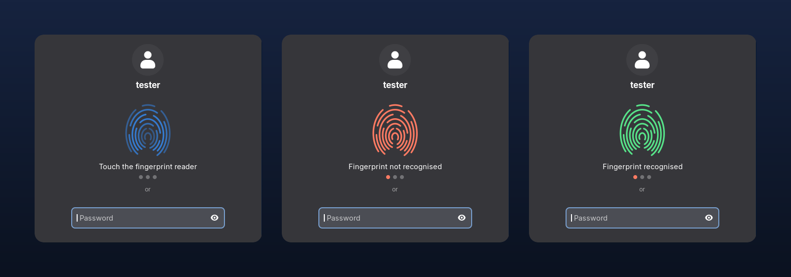
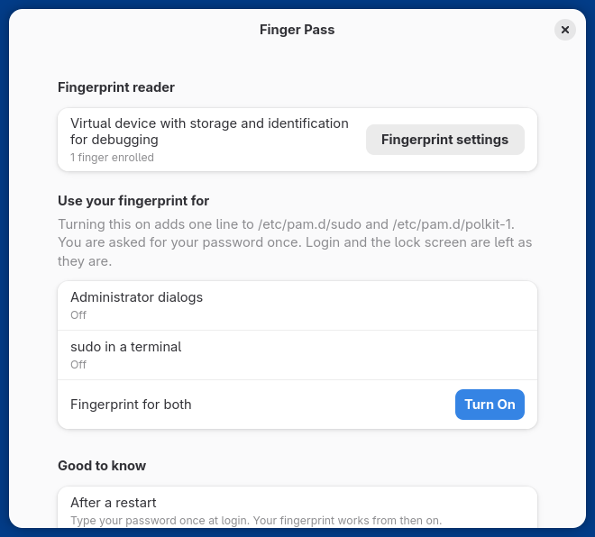
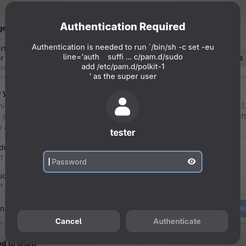
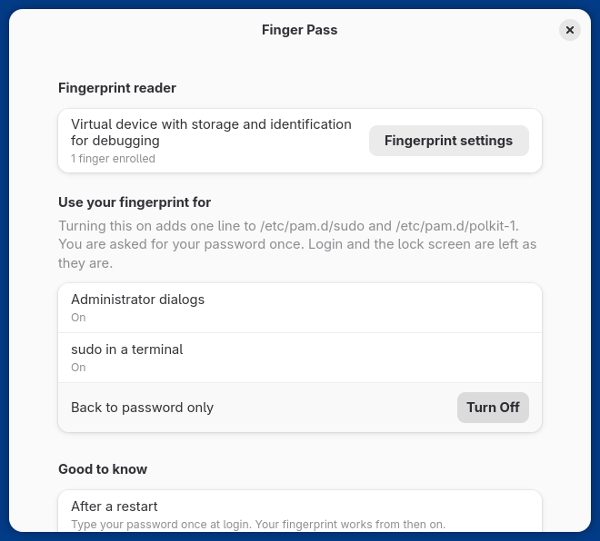
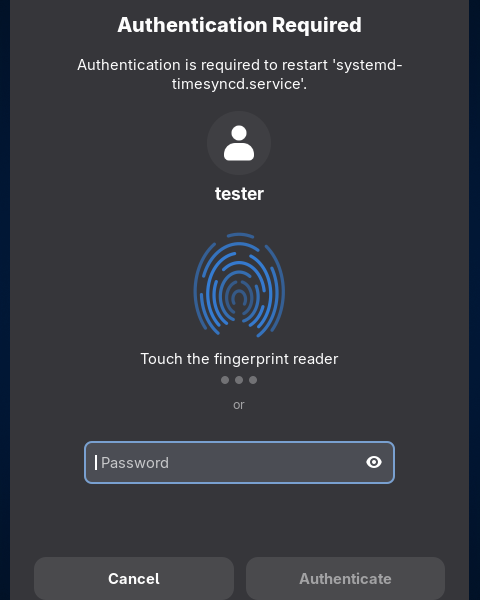
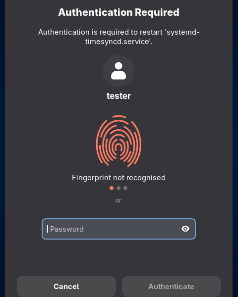
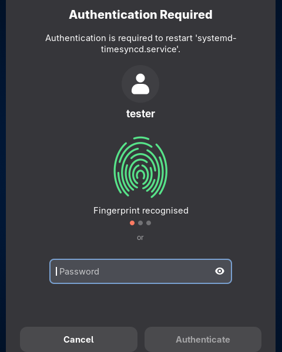
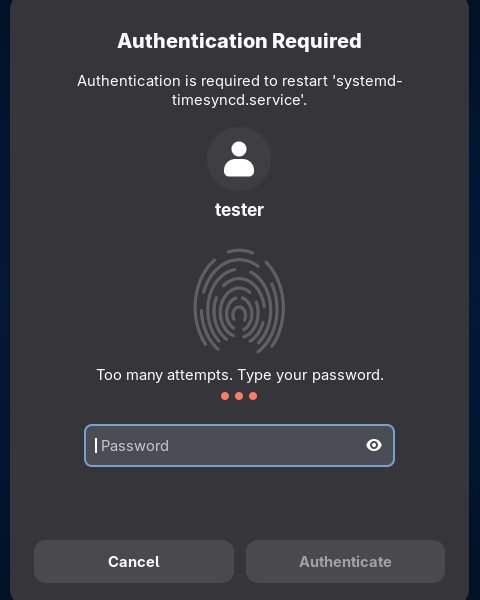

# Finger Pass, step by step

Finger Pass lets you answer administrator prompts with your fingerprint or
your password, whichever comes first.

## Before you start

You need a fingerprint reader that Linux supports and at least one finger
enrolled. Open **Settings › System › Users** and use **Fingerprint Login** to
enrol one. Two fingers are better than one.

## 1. Open the preferences

Open the **Extensions** app, find **Finger Pass** and click its settings
button. The window shows your reader, how many fingers are enrolled, and
where the fingerprint is used. On a fresh system both lines say *Off*.

## 2. Turn it on

Click **Turn On**. You are asked for your password, once. The prompt shows
the exact command that is about to run as administrator: it adds one line to
`/etc/pam.d/sudo` and `/etc/pam.d/polkit-1`, after saving the originals in
`/var/backups/finger-pass`.

Both lines now say *On*.

## 3. Use it

Whenever an application needs administrator rights, the dialog shows the
reader and the password field together. Touch the reader or start typing:
there is nothing to wait for.

A finger that is not recognised turns the print red and uses up one of the
three attempts. Try again, or type your password.

A recognised finger turns it green and the dialog closes.

After three failed attempts the reader is switched off for this request and
the password is the only way in.

## In a terminal

`sudo` prints a hint, then waits 5 seconds for your finger. There is no
password field during that wait. Press **Ctrl+C** to type your password at
once; otherwise the password prompt appears when the 5 seconds are over.
(Typing before that shows your keys on screen, and `sudo` only uses them
afterwards: it is a known limit of `sudo-rs`.)

## Good to know

- After a restart, type your password once at login. The fingerprint works
  from then on, including on the lock screen.
- Over SSH the fingerprint is never asked for.
- Locking the screen dismisses a request that is still open.
- Right after a cancelled request the reader can be busy for a few seconds;
  the dialog starts with the password and brings the reader back by itself.

## Going back

Click **Turn Off** in the preferences: the line is removed from both files.
Disabling the extension gives you back the standard dialog; the fingerprint
keeps working for `sudo` and administrator prompts until you turn it off.
